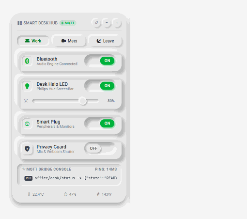

# JavaFX Smart Desk Widget

Neumorphic smart office & IoT desktop widget built with **Java 17**, **JavaFX WebView** and a two-way
Java ↔ JavaScript bridge — scenes, dimmable lights, smart plug and privacy guard with MQTT-style telemetry.

<p align="center">
  
</p>

## Features

- Frameless, transparent, draggable desktop widget (`StageStyle.TRANSPARENT` + transparent `WebView`)
- Quick scenes: **Work**, **Meet**, **Leave**
- Toggles for Bluetooth audio, desk LED (with brightness dimmer), smart plug and privacy guard
- Click a device card to open its detail panel: the window animates from 360px to 680px
  (grows to the left when the widget sits near the right screen edge)
- Live MQTT bridge console, room sensors pushed from Java, estimated power draw
- Pin on top, minimize and close, controlled from the page through the Java bridge

> Device control and MQTT messages are simulated; every publish is printed to the Java console.

## Requirements

- JDK 17 or newer (`java -version`)
- Maven 3.8+ (`mvn -v`)

## Run

```bash
mvn javafx:run
```

## Project Structure

```
pom.xml                                       JavaFX 21 dependencies + javafx-maven-plugin
src/main/java/com/iot/widget/App.java         Window setup, bridge injection, title-bar dragging, Java -> JS sensor feed
src/main/java/com/iot/widget/JavaBridge.java  window.javaBridge: window controls, expand/collapse animation, publish, log
src/main/resources/ui/index.html              Widget markup + <template> blocks for each detail panel
src/main/resources/ui/style.css               Neumorphic styles
src/main/resources/ui/app.js                  Widget logic and the JS side of the bridge
src/main/resources/ui/vendor/bootstrap-icons  Bundled icon font
```

## Java ↔ JavaScript Bridge

| Direction | How |
|-----------|-----|
| JS → Java | `window.javaBridge.minimize()`, `close()`, `togglePin()`, `fitHeight(h)`, `expandWindow(type)`, `collapseWindow()`, `publish(topic, json)`, `log(level, msg)` |
| Java → JS | `engine.executeScript(...)` calling `onJavaBridgeReady()`, `onSensorUpdate(t, h)`, `setDetailSide(side)`, `onWindowExpanded(type)`, `onWindowCollapsed()` |

- Plug a real MQTT client (e.g. Eclipse Paho) into `JavaBridge.publish`. Calls coming from other threads must
  go through `Platform.runLater(...)` before touching the page.
- Any element with `data-drag-region` drags the window; `data-no-drag` excludes its children (e.g. buttons).
- Detail panel content lives in `<template id="detail-TYPE">` blocks; controls inside publish through
  `data-topic` attributes.

## License

MIT
